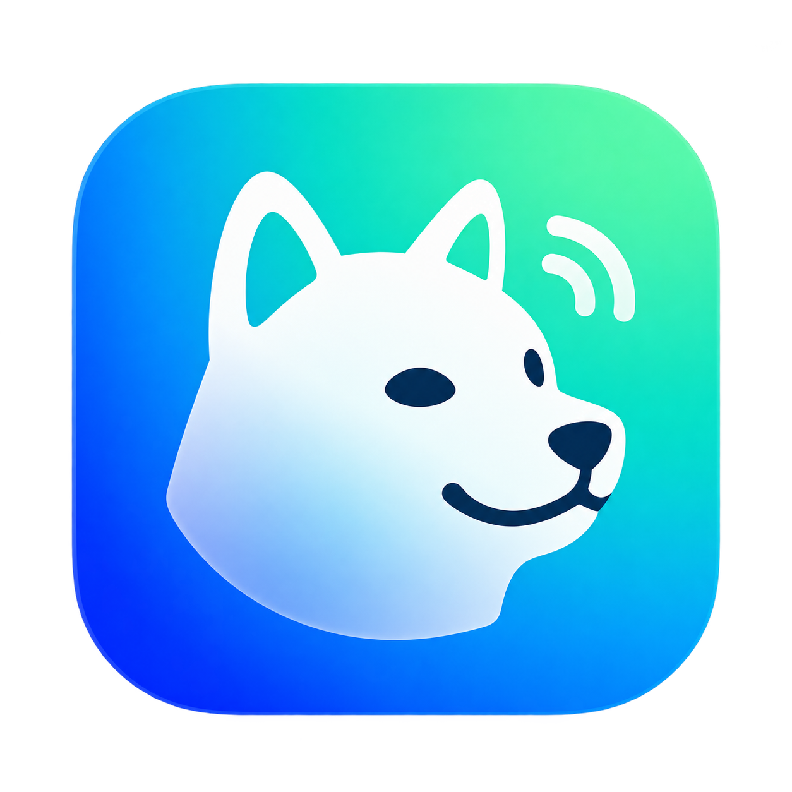
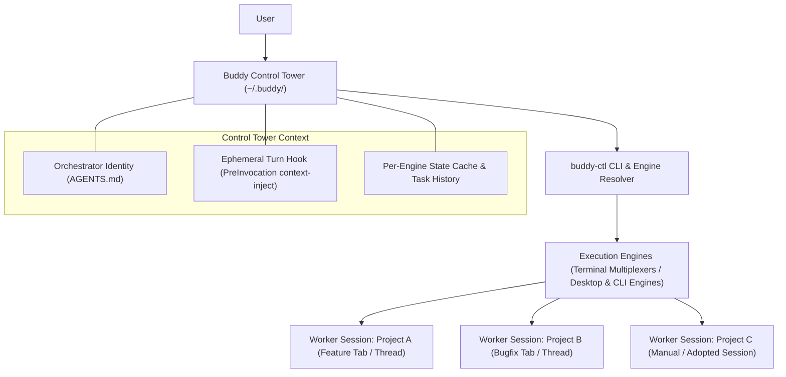
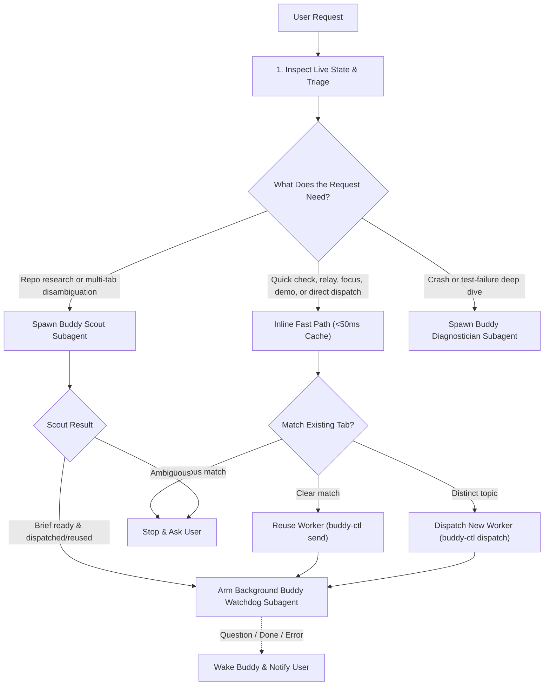

<div align="center">
  
  <h1>Buddy</h1>
  <p>
    Single-session, multi-engine AI orchestrator and CLI for managing concurrent project sessions, feature tabs, and coding agent threads across terminal multiplexers and desktop/CLI coding engines—without cognitive overload or context drift.
  </p>
</div>

---

## Why Buddy?

Working with AI coding agents across multiple repositories quickly turns into tab chaos:

- **Constant context-switching**: You bounce between dozens of terminal tabs or desktop threads just to remember what each agent is working on.
- **Silent blockers**: A worker sits idle waiting for a one-line answer while you are busy in another project.
- **Scattered state**: Manually tracking which branch, tab, or session belongs to which task drains focus and breaks flow.

**Buddy flips the model.** Instead of babysitting every session yourself, you talk to **one** central orchestrator session: **Buddy**. Buddy dispatches tasks to isolated workers, tracks progress across every project, watches for questions or failures in the background, and brings only what needs your attention back to you. Every worker still runs as a real tab or thread—so you can **zoom into any session directly** whenever you want to inspect output, pair-program, or test a demo.

### Everyday Scenarios

- **Dispatch work across repos**: *"Hey Buddy, add inline comment shortcuts to `docnotate` and fix the timeout bug in `daily-catch`."* -> Buddy resolves each repo, spins up dedicated worker tabs/threads, verifies prompt pickup, and monitors them in the background.
- **Check progress & unblock workers**: *"How's `docnotate` going?"* -> Buddy reads live status in milliseconds, surfaces any clarifying questions from the worker, and relays your answer right back.
- **Review & demo finished work**: *"Show me a demo of `docnotate`."* -> Buddy opens a side-by-side dev server pane next to the worker (or focuses the active session) so you can inspect the result immediately.
- **Work outside Buddy anytime**: Open a manual tab, answer a worker directly, or start a session on your own—Buddy reconciles with live panes/threads and can adopt manual sessions on demand.

---

## Features

### Supported Engines

Buddy routes execution through pluggable engines, each with its own isolated state cache (`~/.buddy/state/<engine>.json`):

| Engine | Type | Highlights | Docs |
| :--- | :--- | :--- | :--- |
| **`rex`** | Terminal multiplexer *(default)* | Manages Rex sessions, task tabs, side-by-side dev demo panes, and live TUI probing. | — |
| **`wezterm`** | Terminal multiplexer | Manages WezTerm sessions, tabs, and panes with configurable terminal agent harnesses. | — |
| **`opencode`** | Desktop / HTTP-SSE server | Connects directly to OpenCode's shared local background server (`opencode serve --service`) so dispatched sessions appear live in OpenCode Desktop. | [OpenCode Desktop Guide](docs/opencode-desktop.md) |
| **`t3`** | CLI thread engine | Drives the local `t3` CLI to register projects, start/message threads, and monitor thread status. | — |

### Standout Features

| Feature | What It Does |
| :--- | :--- |
| **Single Control Tower (`~/.buddy/`)** | Keeps orchestrator instructions isolated from your repos—Buddy coordinates work and never edits project files directly. |
| **Adaptive Engine Detection** | Automatically detects your active host environment (`rex`, `opencode`, `t3`) or falls back to your configured default engine. |
| **O(1) Local State Cache & Audit Log** | Tracks active projects, tabs, and threads per engine for sub-50ms status checks, and archives cleaned tasks to `~/.buddy/history/tasks.jsonl`. |
| **Zero-Bloat Context Injection** | Injects live task status transiently on each turn via a `PreInvocation` hook and discards it afterward so chat history stays lean. |
| **Confidence-Gated Tab Reuse** | Automatically reuses matching tabs, asks before duplicating ambiguous work, and creates fresh tabs for distinct tasks. |
| **Background Watchdog & Alerts** | Monitors active workers asynchronously in a subagent and notifies you (including macOS desktop alerts) when input is needed or work completes. |
| **Live Reconciliation & Tab Adoption** | Treats live panes/threads as the source of truth and lets Buddy adopt sessions you started manually outside Buddy. |
| **Flexible Agent & Model Routing** | Mix and match orchestrator vs. worker harnesses (`agy`, `opencode`, `pi`, `claude`, `codex`, `cursor`, `gemini`), discover models, and override `--model` per task. |
| **Multi-Repo Batching & Live Demos** | Dispatch tasks across multiple repositories in parallel (`batch`) and launch side-by-side dev servers (`demo`) or focus any session (`focus`). |
| **Interactive Setup & Self-Healing Doctor** | Guided TUI onboarding (`buddy-ctl setup`) and environment diagnostics with safe auto-repair (`buddy-ctl doctor --fix`). |

---

## Installation

Clone the repository and run the installer:

```sh
git clone https://github.com/tortoise10h/buddy.git
cd buddy
./install.sh          # Downloads pre-built binary (falls back to local Go build if needed)
./install.sh --build  # Or build locally from source with Go
```

`install.sh` installs `buddy` and `buddy-ctl` into `~/.local/bin/` and launches the interactive **`buddy-ctl setup`** wizard, which:

1. Scans your machine for installed engines, agent harnesses, and project directories.
2. Lets you pick your project roots, default engine, orchestrator/worker agents, and skill targets.
3. Provisions `~/.buddy/` (`config.json`, `AGENTS.md`, `.agents/hooks.json`, and state directories) and checks your `$PATH`.

### Maintenance & Headless Installs

```sh
./install.sh                   # Re-run to upgrade & refresh assets (preserves custom edits)
buddy-ctl setup                # Re-run the interactive setup wizard anytime
buddy-ctl setup --only engines # Reconfigure a single section (projects, engines, agents, skills, assets)
buddy-ctl doctor               # Check PATH, ~/.buddy/, hooks, engines, and harnesses
buddy-ctl doctor --fix         # Automatically repair safe issues
```

For automated or CI installs, run with `BUDDY_NONINTERACTIVE=1 ./install.sh` (or `buddy-ctl setup --yes`).

### Engine-Specific Setup Guides

- **OpenCode Desktop**: See [docs/opencode-desktop.md](docs/opencode-desktop.md) for shared background service verification, auto-detection details, and optional default model configuration.

---

## Quick Start

### Terminal Engines (`rex` / `wezterm`)

Launch Buddy from any terminal tab—it automatically starts your configured orchestrator agent with working directory `~/.buddy/`:

```sh
buddy
```

*(Override the orchestrator harness on demand with `buddy opencode`, `buddy -a pi`, or pass flags through with `buddy -- --model pro`.)*

Then talk to Buddy in natural language:
- *"Dispatch a task on `myapp` to add dark mode toggle."*
- *"What's the status across my active tasks?"*
- *"Tell the `myapp` worker to use CSS variables, then show me a demo when it's ready."*

### OpenCode Desktop (`opencode`)

1. Open **OpenCode Desktop** and open **`~/.buddy`** as a project folder.
2. Start a new session and talk to Buddy just like above.
3. Buddy auto-detects OpenCode Desktop—dispatched worker sessions appear live in OpenCode Desktop so you can inspect or jump into them anytime.

See [docs/opencode-desktop.md](docs/opencode-desktop.md) for full details.

### T3 Code (`t3`)

1. Configure your default T3 provider and model during `buddy-ctl setup` (or via CLI):
   ```sh
   buddy-ctl config set engines.t3.provider <provider>
   buddy-ctl config set engines.t3.model <model>
   ```
2. Open `~/.buddy` in T3 Code (auto-detected), or dispatch directly from any terminal with `--engine t3`:
   ```sh
   buddy-ctl dispatch -p myapp --engine t3 -m "Investigate sync race condition"
   ```

### Checking or Switching Engines Anytime

```sh
buddy-ctl engine                    # See detected host and active engine
buddy-ctl status --engine opencode  # Target a specific engine for one command
BUDDY_ENGINE=wezterm buddy-ctl status  # Override via environment variable
```

---

## How Buddy Works

### High-Level Architecture



Buddy cleanly separates **orchestration** from **execution**:

1. **Isolated Control Tower (`~/.buddy/`)**: Buddy runs in its own home directory with an always-on orchestrator prompt (`AGENTS.md`). Because it lives outside your project repositories, worker agents never inherit Buddy's orchestrator rules.
2. **Ephemeral Turn Context**: Before every turn, a lightweight hook injects a compact snapshot of active projects and tasks, then discards it after the turn so long conversations don't accumulate stale status noise.
3. **Engine-Agnostic Controller (`buddy-ctl`)**: Buddy delegates all operational actions to the `buddy-ctl` Go CLI. An adaptive engine resolver picks the right execution engine (flag -> env var -> host auto-detection -> config default) and reads/writes that engine's isolated O(1) state cache.
4. **Real Worker Surfaces**: Each task runs as a genuine tab or thread inside your chosen engine, working directly in the target repository while Buddy stays lightweight and responsive.

### Execution Flow

To keep chat fast and prevent codebase exploration or long polling from bloating the main conversation, Buddy routes each turn across inline actions and isolated subagents:



- **Thinking & Triage**: On every message, Buddy reads the injected live state (syncing with live sessions if stale) and checks whether the request matches an existing task or needs repo context first.
- **Inline Fast Path**: Status checks, quick output captures, answering a worker (`send`), focusing/demoing a tab, and self-contained dispatches run immediately on the main thread. If a request looks related to an open task but is ambiguous, Buddy stops and asks before creating a duplicate.
- **Subagent Delegation**:
  - **Buddy Scout**: When a request requires reading project code or inspecting git history to write a solid prompt brief, Buddy spawns a Scout subagent so file contents never bloat the main chat, then dispatches once the brief is ready.
  - **Buddy Diagnostician**: Deep log/stack-trace analysis runs in an isolated subagent via `buddy-ctl diagnose`.
  - **Buddy Watchdog**: After any dispatch or resumed task, Buddy spawns a background Watchdog subagent running `buddy-ctl watch`. It monitors the smallest necessary scope (single task, single project, or all projects) and wakes Buddy the moment a worker asks a question, finishes, or hits an error.

### Orchestrator & Worker Roles

Buddy's configuration (`~/.buddy/config.json`) separates **who coordinates** from **who executes** and **where execution runs**:

- **Orchestrator**: The single agent session you talk to in `~/.buddy/`. Its job is high-level coordination—understanding your goals, triaging requests, relaying questions, and surfacing results. It never modifies project files directly.
- **Worker Agent & Engine Backend**: The isolated coding session that actually reads files, writes code, and runs tests inside a project directory.
  - On **terminal engines** (`rex`, `wezterm`), you can independently configure the `orchestrator_agent` and `worker_agent` harnesses (for example, using `opencode` as your orchestrator while dispatching `agy` or `pi` workers), and override either the `--agent` or `--model` on any task.
  - On **desktop/API engines** (`opencode`, `t3`), the app or CLI itself hosts the session while Buddy configures the target provider, model, or agent mode for dispatched worker threads.

You can adjust these roles anytime through `buddy-ctl setup` or `buddy-ctl config set`.

---

## CLI Reference (`buddy-ctl`)

While Buddy calls `buddy-ctl` automatically on your behalf, you can also run any command directly for scripting, debugging, or manual control. Run `buddy-ctl --help` or `buddy-ctl <command> --help` for full flag details.

### Setup, Diagnostics & Discovery

| Command | Description |
| :--- | :--- |
| `buddy-ctl setup` | Interactive onboarding wizard (`--only <section>`, `--upgrade`, `--yes`, `--dry-run`) |
| `buddy-ctl doctor` | Diagnose installation, config, hooks, engines, and harnesses (`--fix`, `--json`, `--strict`) |
| `buddy-ctl init` | Initialize `~/.buddy/` directory and default config/state |
| `buddy-ctl engine` *(alias: `host`)* | Show detected host environment and active engine resolution (`--engine`, `--json`) |
| `buddy-ctl projects` | List discovered repos (`--query`) or manage roots (`roots`, `add-root`, `remove-root`) |
| `buddy-ctl config` | Inspect or update `~/.buddy/config.json` (`show`, `get <key>`, `set <key> <val>`) |
| `buddy-ctl models` | List available models for an engine or agent (`--agent`, `--engine`, `--query`, `--format`) |
| `buddy-ctl version` | Print CLI version, commit, and build date |

### Dispatch & Task Lifecycle

| Command | Description |
| :--- | :--- |
| `buddy-ctl dispatch` | Atomic dispatch: slugify, spawn worker, inject prompt, verify pickup (`-p`, `-m`, `-t`, `--agent`, `--model`, `--engine`, `--force`) |
| `buddy-ctl batch` | Dispatch multiple tasks across repos concurrently (`--json`, `--file`) |
| `buddy-ctl task start` | Start a new worker tab/thread (`-p`, `-t`, `--prompt`, `--agent`, `--model`, `--engine`) |
| `buddy-ctl task adopt` | Bring an out-of-band manual tab/session under Buddy tracking (`-p`, `-w`, `-t`, `--agent`) |
| `buddy-ctl task update` | Update tracked status or summary (`-p`, `-t`, `--status`, `--summary`) |
| `buddy-ctl task close` | Stop/close a worker tab or interrupt an active desktop session (`-p`, `-t`) |
| `buddy-ctl task clean` | Remove closed tasks from active state and append audit log (`-p`, `-t`, `--close`, `--all-closed`, `--reason`) |
| `buddy-ctl task history` | View archived task audit history (`-p`, `--limit`) |

### Inspection, Interaction & Monitoring

| Command | Description |
| :--- | :--- |
| `buddy-ctl status` | View tracked projects, tasks, and untracked tabs (`--sync`, `--no-sync`, `--format`, `-p`, `--engine`, `--all-engines`) |
| `buddy-ctl capture` | Read recent output/scrollback from a worker (`-p`, `-t`, `--lines`, `--raw`) |
| `buddy-ctl send` | Relay text or a keypress to an active worker (`-p`, `-t`, `--text`, `--key`) |
| `buddy-ctl focus` | Focus a worker tab or session (`-p`, `-t`) |
| `buddy-ctl demo` | Open a side-by-side dev server pane next to a worker (`-p`, `-t`, `--cmd`, `--focus-only`) |
| `buddy-ctl watch` | Poll task(s) until input, demo, completion, or error (`-p`, `-t`, `--all`, `--interval`, `--timeout`) |
| `buddy-ctl diagnose` | Extract error snippets and failure context from worker output (`-p`, `-t`, `--lines`) |
| `buddy-ctl notify` | Send a macOS desktop notification (`--title`, `--message`) |

### Common Examples

```sh
# Check status across all projects (or across every configured engine)
buddy-ctl status --format table
buddy-ctl status --sync --all-engines

# Dispatch a task (include any planning instructions directly in --prompt)
buddy-ctl dispatch -p docnotate -m "Add keyboard shortcut to resolve inline comments"
buddy-ctl dispatch -p docnotate -t perf-fix -a pi -M gemini-4-neon-high -m "Profile render loop"

# Inspect output, answer a worker, or open a live demo
buddy-ctl capture -p docnotate -t perf-fix
buddy-ctl send -p docnotate -t perf-fix --text "Use requestAnimationFrame batching"
buddy-ctl demo -p docnotate -t perf-fix --cmd "npm run dev"

# Watch active work, adopt a manual tab, or clean up finished tasks
buddy-ctl watch --all --interval 5 --timeout 600
buddy-ctl task adopt -p docnotate -w manual-refactor
buddy-ctl task clean --all-closed --reason "merged"
```

---

## Documentation & Reference

- [OpenCode Desktop Integration Guide](docs/opencode-desktop.md)
- [Buddy Orchestrator Skill](skills/buddy/SKILL.md)
- [Control Tower System Prompt Template](templates/orchestrator-AGENTS.md)
