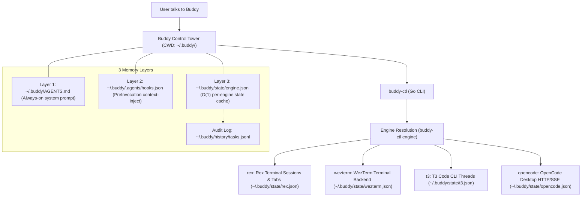
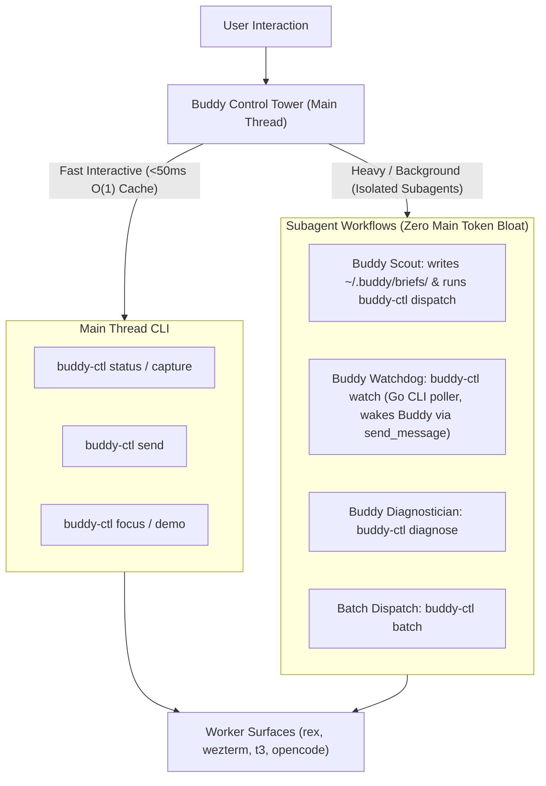

# Buddy

Single-session multi-engine orchestrator and agent skill for managing concurrent project sessions, feature tabs, and agent threads across **Rex**, **WezTerm**, **T3 Code**, and **OpenCode Desktop** without cognitive overload or context drift.

---

## The Vision

Instead of manually navigating dozens of terminal tabs or desktop threads across projects to see which agent is blocked or waiting for input, you talk to **one** control session: **Buddy**.

- **Dispatch work**: *"Hey Buddy, add inline comment shortcuts to Docnotate"* -> Buddy resolves the project and active engine (`rex`, `wezterm`, `t3`, or `opencode`), creates a dedicated task tab or thread, launches the configured worker agent (e.g. `agy`, `pi`, `opencode`, or a T3 model), starts work, and relays questions back to you.
- **Check progress**: *"Hey, how is the Docnotate task going?"* -> Buddy checks state in O(1) via its per-engine local state cache (`~/.buddy/state/<engine>.json`), summarizes progress or clarifying questions, and relays your answers back to the worker.
- **Review / Demo**: *"Show me a demo"* -> Buddy splits a dev server pane beside the worker and focuses the tab in Rex (or focuses the active session).

---

## Architecture & Memory Layers

Buddy solves the 3 core multi-project orchestration challenges and routes execution across all 4 supported engines:



1. **Always-On System Prompt Identity**: `~/.buddy/AGENTS.md` (symlinked from `templates/orchestrator-AGENTS.md`) is injected on every turn and survives `/compact`. Because it lives in `~/.buddy/`, worker agents in project repositories never inherit it.
2. **Ephemeral Turn Injections (Zero History Bloat)**: `~/.buddy/.agents/hooks.json` (generated from `templates/hooks.json` with resolved binary paths) runs `buddy-ctl context-inject` on `PreInvocation`, emitting a transient `ephemeralMessage` with active project statuses that is discarded immediately after the turn.
3. **Per-Engine O(1) Local State Cache & Audit History**: State is isolated per engine under `~/.buddy/state/<engine>.json` (`rex.json`, `wezterm.json`, `t3.json`, `opencode.json`), mapping projects and tasks to exact session, window, block, or thread IDs without slow full-host scans. When tasks are cleaned up via `buddy-ctl task clean`, immutable audit records are appended to `~/.buddy/history/tasks.jsonl`.

---

## Hybrid Execution Model

Buddy separates fast, interactive control-tower lookups from heavy or long-running background work:



| Workflow | Execution Mode | Tools Used | Why |
| :--- | :--- | :--- | :--- |
| **Status, Quick Capture, Q&A Relay, Focus, Demo** | **Main Thread** | `buddy-ctl status`, `capture`, `send`, `focus`, `demo` | O(1) cache lookup (<50ms). Instant interactive replies. |
| **Investigatory Dispatch (`Buddy Scout`)** | **Subagent** | `invoke_subagent` / `delegate_task` (`Role: 'Buddy Scout'`) + `buddy-ctl dispatch` | Writes brief to `~/.buddy/briefs/` and dispatches; keeps codebase reading out of the main transcript and the chat responsive. |
| **Background Watchdog (`Buddy Watchdog`)** | **Subagent** | `invoke_subagent` (`Role: 'Buddy Watchdog'`) + `buddy-ctl watch` | Runs the Go `buddy-ctl watch` polling loop asynchronously for questions/completion; alerts main Buddy via `send_message` without blocking user chat. |
| **Deep Pane Diagnosis (`Buddy Diagnostician`)** | **Subagent** | `invoke_subagent` (`Role: 'Buddy Diagnostician'`) + `buddy-ctl diagnose` | Analyzes large scrollback/stack traces in isolation without cluttering main transcript. |
| **Batch Multi-Repo Dispatch** | **Subagents / Batch CLI** | `buddy-ctl batch` or parallel `invoke_subagent` | Dispatches tasks across multiple repos concurrently. |

---

## Installation

Clone and run the installer:

```sh
cd /Users/sunday/Dev/Personal/Projects/buddy
./install.sh           # Downloads pre-built binary (or compiles with Go if release unavailable)
./install.sh --build   # Or build locally from source with Go (tracks latest code on main)
```

`install.sh` installs `buddy` and `buddy-ctl` into `~/.local/bin/` and hands off onboarding directly to **`buddy-ctl setup`**:

- **First-time interactive install**: Launches the interactive `buddy-ctl setup` TUI wizard (powered by `charm.land/huh/v2`), which:
  1. Probes your machine for installed engines (`rex`, `opencode`, `t3`, `wezterm`), agent harnesses (`agy`, `opencode`, `pi`, `claude`, `codex`, `cursor`, `gemini`), and existing project directories (with live repo counts).
  2. Configures your project roots, default fallback engine, optional T3/OpenCode defaults, terminal orchestrator & worker harnesses, and agent skill targets.
  3. Provisions `~/.buddy/` (`config.json`, `state/<engine>.json`, `AGENTS.md`, `.agents/hooks.json`) and selected agent skill directories from embedded assets (or symlinks to the repo when using `--build` / `--dev-link`).
  4. Checks your `$PATH` and prints next steps.
- **Upgrades**: Re-running `./install.sh` on an existing installation automatically runs `buddy-ctl setup --upgrade`, refreshing managed assets without re-prompting or clobbering your custom edits.
- **Reconfigure or diagnose anytime**:
  ```sh
  buddy-ctl setup                # Re-run the interactive onboarding wizard
  buddy-ctl setup --only engines # Reconfigure a single section (projects, engines, agents, skills, assets)
  buddy-ctl doctor               # Diagnose PATH, ~/.buddy/, hooks, skills, roots, engines, and harnesses
  buddy-ctl doctor --fix         # Automatically repair safe issues
  ```
- **Headless / CI installs**: Set `BUDDY_NONINTERACTIVE=1` (or pass `buddy-ctl setup --yes`) along with optional environment variables:
  - `BUDDY_PROJECTS_ROOTS="dir1:dir2"`
  - `BUDDY_DEFAULT_ENGINE="rex"` (`rex`, `wezterm`, `t3`, or `opencode`)
  - `BUDDY_ORCHESTRATOR_AGENT="opencode"`
  - `BUDDY_WORKER_AGENT="agy"`
  - `BUDDY_T3_PROVIDER="antigravity"` and `BUDDY_T3_MODEL="antigravity/gemini-3.8-flash-medium"`
  - `BUDDY_OPENCODE_MODEL="<provider>/<model>"`

---

## Multi-Engine Support & Resolution

Buddy supports 4 execution engines, each with isolated state in `~/.buddy/state/<engine>.json`:

| Engine | State File | Description |
| :--- | :--- | :--- |
| **`rex`** | `~/.buddy/state/rex.json` | Default terminal engine. Manages Rex sessions, tabs, split dev panes, and live TUI reconciliation. |
| **`wezterm`** | `~/.buddy/state/wezterm.json` | Terminal multiplexer engine option configurable via `default_engine` / `BUDDY_DEFAULT_ENGINE`. |
| **`t3`** | `~/.buddy/state/t3.json` | Drives the local `t3` CLI to register projects, start/message threads, and probe live thread status. |
| **`opencode`** | `~/.buddy/state/opencode.json` | Connects directly to the shared local OpenCode v2 HTTP/SSE server (`opencode serve --service`) used by OpenCode Desktop and `opencode` CLI. |

### Adaptive Engine Resolution (`buddy-ctl engine`)
Inspect host detection and active engine resolution at any time:

```sh
buddy-ctl engine                    # Alias: buddy-ctl host
buddy-ctl engine --json
buddy-ctl engine --engine opencode
```

Buddy resolves the active engine using a 5-tier precedence order:
1. Explicit CLI flag (`--engine <name>`)
2. Environment override (`BUDDY_ENGINE`, then `BUDDY_WORKER_BACKEND`)
3. Automatic host detection (`rex`, `t3`, or `opencode`)
4. User configuration (`config.default_engine`, configurable via `BUDDY_DEFAULT_ENGINE` in `install.sh` or `buddy-ctl config set default_engine <name>`)
5. Fallback default: `"rex"`

### T3 Code Engine (`--engine t3`)
When dispatching to T3, Buddy requires a `<provider>/<model>` specification, resolved in order from:
1. `--agent <provider>/<model>` on `dispatch` or `task start`
2. `BUDDY_T3_MODEL=<provider>/<model>` environment variable
3. `engines.t3.provider` and `engines.t3.model` in `~/.buddy/config.json`:

```sh
buddy-ctl config set engines.t3.provider antigravity
buddy-ctl config set engines.t3.model gemini-3.8-flash-medium
buddy-ctl dispatch -p docnotate --engine t3 -m "Investigate sync race"
```

See [docs/t3-integration-progress.md](docs/t3-integration-progress.md) for current T3 capabilities and known caveats.

### OpenCode Desktop Engine (`--engine opencode`)
OpenCode v2 runs a shared local background server (`opencode serve --service`) that both **OpenCode Desktop** and the **`opencode` CLI** attach to. Buddy can orchestrate OpenCode Desktop sessions directly over its local HTTP/SSE API using `--engine opencode` (distinct from running the `opencode` TUI inside Rex via `--engine rex --agent opencode`):

- **Auto-discovery & bootstrap**: Reads `~/.local/state/opencode/service.json` (with `BUDDY_OPENCODE_URL` / `OPENCODE_SERVER_URL` and `engines.opencode.server_url` overrides) and can auto-start the shared background service via `opencode service start`.
- **Shared state**: Tasks dispatched with `buddy-ctl dispatch -p <project> -m "..." --engine opencode` appear immediately in OpenCode Desktop; sessions created directly in OpenCode Desktop or `opencode` CLI (active or updated within 24h, capped at 10 per project) are surfaced by `buddy-ctl status --sync --engine opencode` and can be adopted via `buddy-ctl task adopt`.
- **Non-destructive close**: `buddy-ctl task close --engine opencode` interrupts an actively running turn (`POST /api/session/{id}/interrupt`) and marks the task `"closed"` in `~/.buddy/state/opencode.json` while keeping the session history intact in OpenCode Desktop.

See [docs/opencode-desktop.md](docs/opencode-desktop.md) for full setup and usage details.

---

## Agent Configuration & Roles

Buddy cleanly decouples the agent running the control tower from the agents performing implementation tasks:

1. **Orchestrator Agent** (`orchestrator_agent`, default: `"agy"`):
   - The agent running Buddy itself (the central control session), launched by `bin/buddy`.
   - Handles task routing, status monitoring, QA delegation, and demos.
2. **Worker Agent** (`worker_agent`, default: `"agy"`):
   - The default agent used when Buddy kicks off a new task or implementation tab (`buddy-ctl dispatch`, `buddy-ctl task start`).
   - Executes code modifications, tests, and feature work in project tabs.

### Example: Opencode Orchestrator with Agy Workers
A common setup is using `opencode` to coordinate the Buddy session while using `agy` for worker tasks:

```json
{
  "orchestrator_agent": "opencode",
  "worker_agent": "agy"
}
```

Or configure via `buddy-ctl`:
```sh
buddy-ctl config set orchestrator_agent opencode
buddy-ctl config set worker_agent agy
```

### Pinning a Model (Model Variants)
The install picker intentionally offers agent harnesses only (using each harness's own default model).

To pin an agent to a specific model:
1. Add an entry to the `agents` map in `~/.buddy/config.json` with the model arguments in its `command` array:
   ```json
   {
     "agents": {
       "agy-flash": {
         "command": ["agy", "--model", "gemini-3.8-flash-medium"],
         "submit_delay_ms": 1500,
         "submit_key": "enter"
       }
     }
   }
   ```
2. You can then select that pinned model on demand via `--agent`:
   ```sh
   buddy --agent agy-flash
   buddy-ctl dispatch --project docnotate --agent agy-flash --prompt "Refactor auth"
   ```
   Or set it as the persistent default for either role:
   ```sh
   buddy-ctl config set worker_agent agy-flash
   buddy-ctl config set orchestrator_agent agy-flash
   ```

### Command Array Resolution
Both settings resolve their full command array from `config.agents.<name>.command`. Variant agents configured with command arguments (such as `agy-flash` -> `["agy", "--model", "gemini-3.8-flash-medium"]`) are executed as full argument arrays rather than a single string.

### Resolution Precedence
- **Orchestrator Agent**:
  1. Explicit CLI argument (`buddy --agent <name>`, `buddy -a <name>`, or `buddy <name>`)
  2. `BUDDY_AGENT` environment variable
  3. `config.orchestrator_agent` (set via `install.sh`, `buddy-ctl config set`, or config file)
  4. `config.default_agent` (legacy fallback)
  5. Fallback default: `"agy"`
- **Worker Agent**:
  1. Explicit CLI argument (`buddy-ctl dispatch --agent <name>`, `buddy-ctl task start --agent <name>`)
  2. `config.worker_agent` (set via `install.sh`, `buddy-ctl config set`, or config file)
  3. `config.default_agent` (legacy fallback)
  4. Fallback default: `"agy"`

### Backward Compatibility
Existing `~/.buddy/config.json` files that only define `default_agent` continue to work without modification. The legacy `default_agent` key acts as the fallback for both orchestrator and worker roles when `orchestrator_agent` or `worker_agent` is not explicitly set.

---

## Quickstart

### Launch Buddy
```sh
buddy
```
Starts your orchestrator agent (`agy` by default) directly in the current terminal tab with working directory `~/.buddy/`, regardless of the Rex session name.

Use `buddy --help` (or `-h`) to inspect launcher options, supported agents, and agent resolution rules. To pass options directly through to the agent without interpretation, use `--` (e.g. `buddy -- --model pro`). Unrecognized options passed directly to `buddy` will report an error and the full help message to stderr and exit with code 2.

### CLI Usage (`buddy-ctl`)

Run `buddy-ctl --help` for top-level command usage or `buddy-ctl <subcommand> --help` for command-specific flags. Any unknown options or invalid subcommands print an error and the full help message to stderr and exit with code 2.

```sh
# Inspect host environment detection and resolved engine (alias: host)
buddy-ctl engine [--engine rex|t3|opencode] [--json]

# View tracked projects, tasks, and untracked live tabs (auto-reconciles if cache >45s old)
buddy-ctl status [--format json|brief|table] [--project docnotate]
buddy-ctl status --sync                         # Force immediate live reconcile
buddy-ctl status --no-sync                      # Read cache only (skip TTL reconcile)
buddy-ctl status --engine opencode              # Scope to a specific engine
buddy-ctl status --all-engines                  # Aggregate state across all engines

# List available projects and manage project roots
buddy-ctl projects
buddy-ctl projects --query docnotate
buddy-ctl projects roots
buddy-ctl projects add-root ~/Dev/Work/repos
buddy-ctl projects remove-root ~/Dev/Work/repos

# View or update configuration (~/.buddy/config.json)
buddy-ctl config show
buddy-ctl config get worker_agent
buddy-ctl config set worker_agent agy

# Fast-path atomic dispatch (auto-slug, spawn, prompt, verify pickup in 1 shot)
# Note: Include any planning requirements directly inside --prompt.
buddy-ctl dispatch --project docnotate --prompt "First draft a plan, then add shortcut to resolve comments" [--task inline-comments] [--engine rex|t3|opencode] [--force]

# Task lifecycle: start, adopt, update, close, clean, history
buddy-ctl task start --project docnotate --task inline-comments --prompt "Add shortcut to resolve comments"
buddy-ctl task start --project daily-catch --task sync-engine --agent pi --prompt "Fix sync timeout"
buddy-ctl task adopt --project docnotate --window manual-refactor [--task manual-refactor]
buddy-ctl task update --project docnotate --task inline-comments --status blocked --summary "Waiting for API key"
buddy-ctl task close --project docnotate --task inline-comments
buddy-ctl task clean --project docnotate --task inline-comments --reason "merged and verified"
buddy-ctl task clean --all-closed               # Clean all closed/done tasks and log to ~/.buddy/history/tasks.jsonl
buddy-ctl task history --project docnotate --limit 20

# Inspect worker output (O(1)) and relay input / answers
buddy-ctl capture --project docnotate --task inline-comments
buddy-ctl send --project docnotate --task inline-comments --text "Use Cmd+Shift+E"

# Focus a task tab/session or launch a dev server split demo
buddy-ctl focus --project docnotate --task inline-comments
buddy-ctl demo --project docnotate --task inline-comments --cmd "npm run dev"

# Situational Watchdog: Monitor a single task, all active tasks in one project, or all projects
buddy-ctl watch --project docnotate --task inline-comments --interval 5 --timeout 600
buddy-ctl watch --project docnotate --interval 5 --timeout 600
buddy-ctl watch --all --interval 5 --timeout 600

# Diagnostician: Extract error snippets and failure analysis from worker pane
buddy-ctl diagnose --project docnotate --task inline-comments --lines 300

# Batch dispatch tasks across multiple projects
buddy-ctl batch --json '[{"project":"docnotate","task":"feat-a","prompt":"..."},{"project":"daily-catch","task":"feat-b","prompt":"..."}]'

# Send a macOS desktop notification or check CLI version
buddy-ctl notify --title "Buddy" --message "Docnotate tests passed"
buddy-ctl version
```

---

## Documentation & Reference

- [OpenCode Desktop Integration Guide](docs/opencode-desktop.md)
- [T3 Integration Progress & Caveats](docs/t3-integration-progress.md)
- [Buddy Orchestrator Skill](skills/buddy/SKILL.md)
- [Control Tower System Prompt Template](templates/orchestrator-AGENTS.md)
